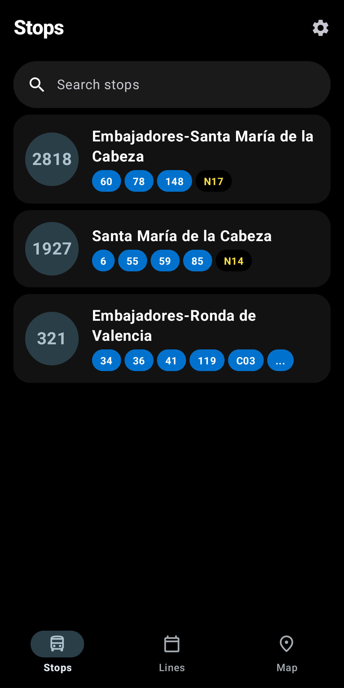
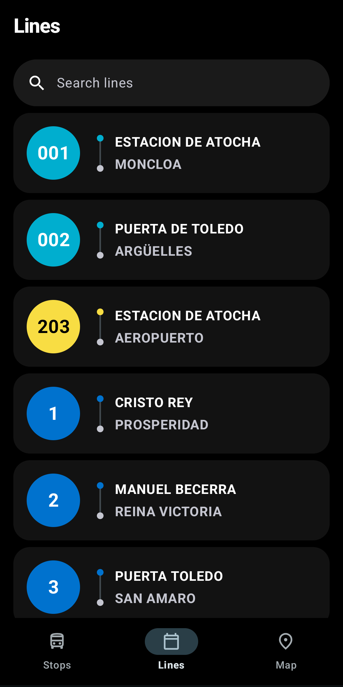
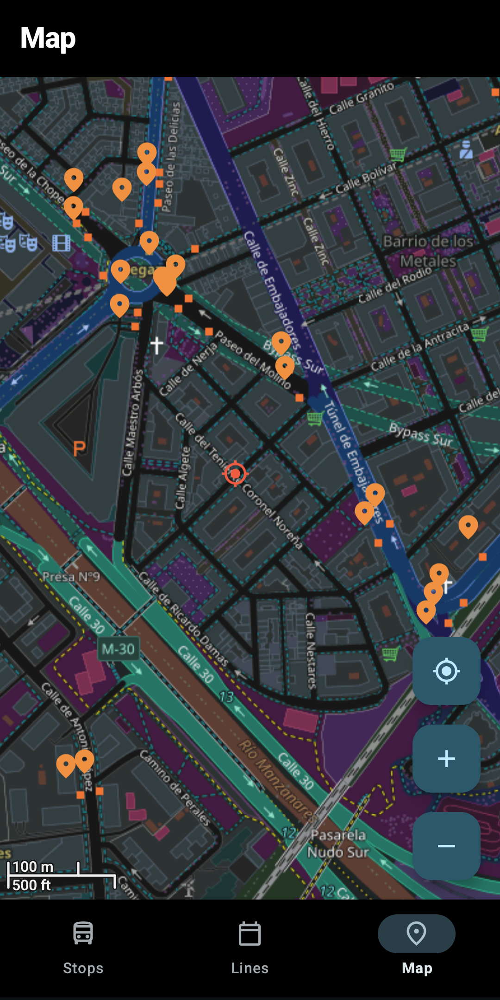
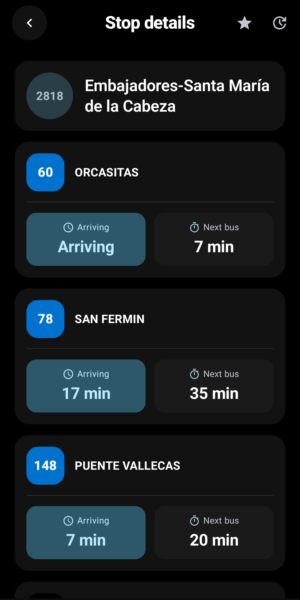
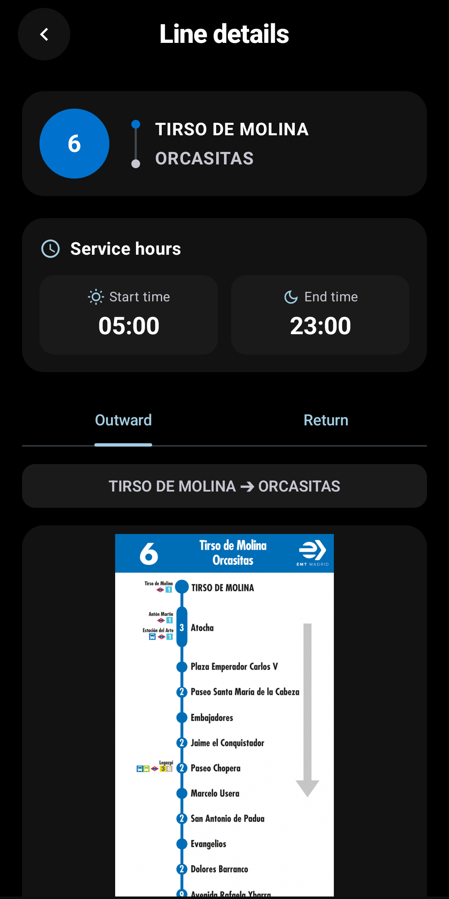
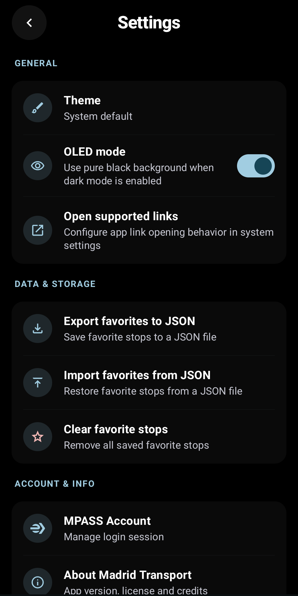

<p align=center>
    
</p>

<h1 align="center">Madrid Transport</h1>

<div display="flex" align=center>
    <a href="https://codeberg.org/DisketteFox/madrid-libre-transport/releases"></a>
    <a href="https://apps.obtainium.imranr.dev/redirect?r=obtainium://add/https://codeberg.org/DisketteFox/madrid-libre-transport/"></a>
</div>


<p align="center">
  
  
  
  
</p>

---

**Madrid Transport** is a free open-source Android app that offers real time information about EMT Madrid bus time arrivals, lines schedules and route details, and interactive transit maps.

---

## Screenshots

<p align="center">
  
  
  
</p>

<p align="center">
  
  
  
</p>

---

# Features

- **Real-Time Bus Arrivals**: Query any EMT bus stop to check live arrival times and bus status.
- **Lines & Routes**: Browse EMT line routes, detailed stops, and operating schedules.
- **Interactive Maps**: Built-in public transport maps for the *Community of Madrid* powered by MapsForge.
- **Favorites Management**: Save and organize your most frequented stops and lines for quick access.
- **Material You Design**: Built with Material 3, supporting system dynamic color matching as well as EMT signature brand colors.
- **Multilingual**: Available in English and Spanish.

---

## Build

1. Clone the repository:
   ```bash
   git clone https://codeberg.org/DisketteFox/madrid-libre-transport.git
   cd madrid-libre-transport
    ```
2. Open the project in Android Studio (Ladybug or newer recommended).
3. Ensure you have JDK 11 or higher configured.
4. Build and run the app:
   ```bash
    ./gradlew assembleDebug
   ```

---

## Tech Stack & Architecture

- **Language**: [Kotlin](https://kotlinlang.org/)
- **UI Framework**: Jetpack Compose & Material 3 components
- **Networking**: [Retrofit 2](https://square.github.io/retrofit/) + [OkHttp 5](https://square.github.io/okhttp/) + Gson
- **Map Rendering**: [MapsForge](https://github.com/mapsforge/mapsforge) vector map engine
- **Async & Architecture**: Kotlin Coroutines, StateFlow, AndroidX ViewModel, ViewBinding
- **Image Loading**: [Coil 3](https://coil-kt.github.io/coil/) & Glide

---

## Requirements

- **OS**: Android 8.0 (API level 26) or higher
- **Network**: Active internet connection (for live arrival data)
- **Storage**: ~210 MB available space

---

## License

Madrid Transport is licensed under the [GNU Affero General Public License v3.0 or later](https://www.gnu.org/licenses/agpl-3.0.html) (AGPL-3.0-or-later). See the `LICENSE` file for the full text.